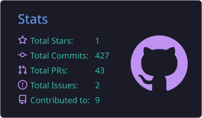
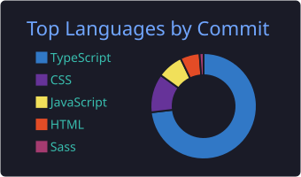

<div align="center">
  
</div>

<div align="center">
  <a href="https://git.io/typing-svg">
    
  </a>
</div>

<br/>

<div align="center">
  
  
</div>

---

## 👨‍💻 `~/sobre-mim`

```ts
const pedro = {
  nome: "Pedro Ramos",
  funcao: "Desenvolvedor Full Stack",
  local: "São Paulo, Brasil 🇧🇷",
  formacao: "Análise e Desenvolvimento de Sistemas",
  stackPrincipal: ["TypeScript", "React", "Node.js", "NestJS"],
  focoAtual: "Arquitetura limpa, boas práticas e design de software",
  hobbies: ["Stardew Valley 🌾", "Explorar novas tecnologias"],
  frase: "Código bom é código que outra pessoa consegue entender.",
};
```

---

## 🛠️ `~/stack`

### Frontend & Design

<p align="left">
  
</p>

### Backend & Infra

<p align="left">
  
</p>

### Ferramentas

<p align="left">
  
</p>

---

## 📊 `~/estatisticas`

<div align="center">
  
  
</div>

<br/>

<div align="center">
  
</div>

<br/>

<div align="center">
  
  
  
  
</div>

---

## 📩 `~/contato`

<div align="center">
  <a href="https://www.linkedin.com/in/pedroramosparaiso/" target="_blank">
    
  </a>
  <a href="mailto:pedrodesenvolvedor06@gmail.com" target="_blank">
    
  </a>
  <a href="https://wa.me/5511954121619" target="_blank">
    
  </a>
  
</div>

<br/>

<div align="center">
  
</div>
